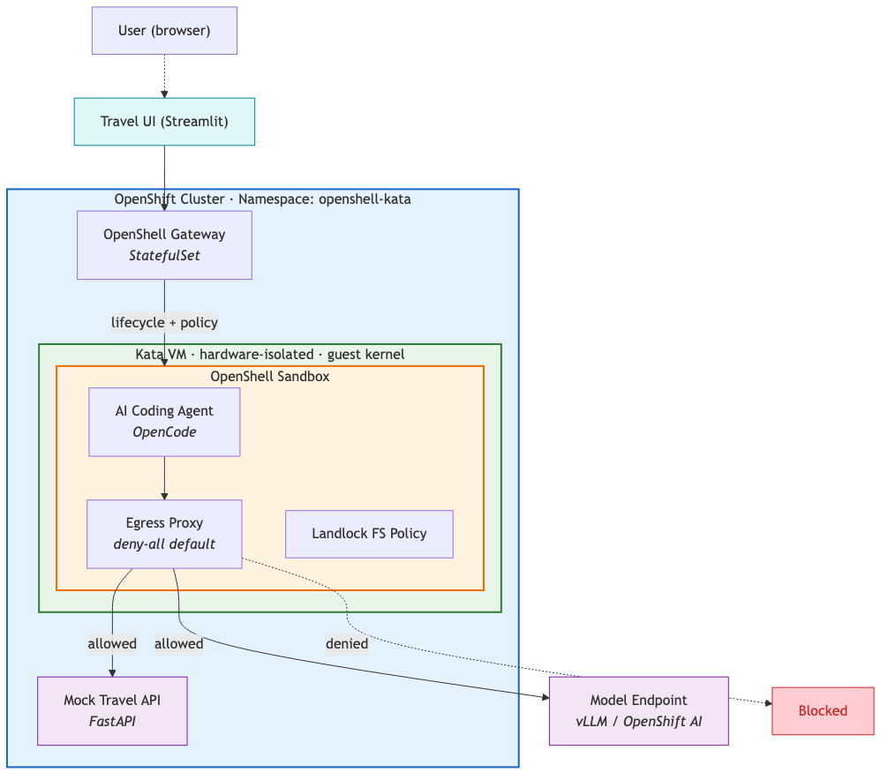
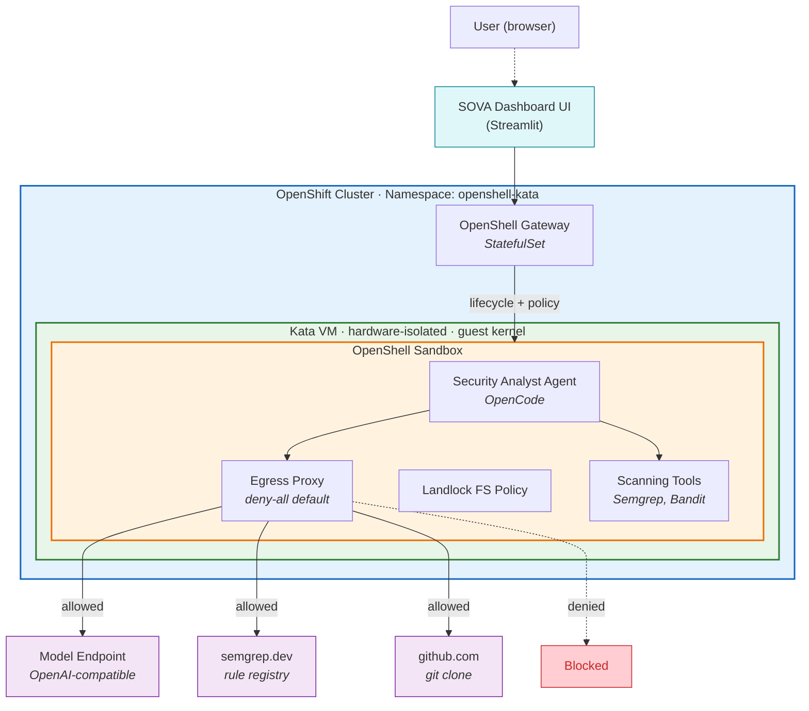

# SOVA - Sovereign Oversight & Vulnerability Agent

Deploy AI-powered vulnerability scanning with defense-in-depth using NVIDIA OpenShell and Kata Containers on Red Hat OpenShift.

## Table of Contents

- [Description](#description)
- [Business Use Case](#business-use-case)
- [Architecture](#architecture)
- [Requirements](#requirements)
- [Quick Start](#quick-start)
- [Deployment Guide](#deployment-guide)
- [Delete](#delete)
- [Security Model](#security-model)
- [References](#references)
- [Tags](#tags)

## Description

AI coding agents need shell access to be productive - running tests,
editing files, installing packages, executing builds. But unrestricted
shell access on a shared cluster creates two distinct threat classes that
must be addressed simultaneously.

**Application-layer threats** such as prompt injection can steer an agent
toward exfiltrating secrets, accessing unauthorized services, or leaking
credentials through network channels. These attacks use normal
application behavior and do not require any runtime vulnerability.

**Kernel-level threats** such as container escape exploits allow
malicious code to break out of the container boundary, access the host
filesystem, or move laterally to other workloads. Since agents routinely
execute untrusted code (`pip install`, `npm install`, arbitrary shell
commands), the kernel attack surface is directly exposed.

This reference architecture deploys AI coding agents inside a
dual-protection boundary: **NVIDIA OpenShell** enforces application-layer
policies (network egress allowlisting, filesystem restrictions, process
isolation), while **Kata Containers** provides hardware-enforced VM
isolation at the kernel level. Together they cover threat classes that
neither technology addresses alone.

## Business Use Case

This quickstart deploys **SOVA (Sovereign Oversight & Vulnerability Agent)**: an enterprise-grade,
privacy-first vulnerability scanning platform where users submit Git repository URLs and receive
comprehensive security analysis with SARIF-formatted vulnerability reports.

**Key Features:**
- **Sandboxed Scanning:** Analyzes untrusted code safely inside Kata VM + OpenShell boundary
- **Industry-Standard Tools:** Integrates Semgrep, Bandit for SAST analysis
- **Multi-Ruleset Coverage:** p/security-audit, p/python, p/owasp-top-ten (694 total rules)
- **Reachability Analysis:** 🆕 Reduces false positives by 70-80% via code graph analysis (see [docs/REACHABILITY_ANALYSIS.md](docs/REACHABILITY_ANALYSIS.md))
- **AI-Assisted Triage:** OpenCode agent formats results and extracts severity metrics
- **SARIF Compliance:** Structured vulnerability reports with CWE classifications
- **Network Isolation:** Policy-enforced egress control prevents data exfiltration

**When to Use SOVA:**
- ✅ Scanning untrusted open-source dependencies
- ✅ Analyzing code from external contributors
- ✅ Compliance scenarios requiring isolation (SOC2, PCI-DSS)
- ✅ Supply chain security (scanning all npm/pip dependencies)
- ✅ Bug bounty submissions from unknown researchers
- ✅ 🆕 **Lightwell customers:** Automated triage of vulnerabilities with reachability filtering

**When to Use Direct Semgrep/Bandit:**
- ✅ Scanning your own trusted code
- ✅ CI/CD integration (GitHub Actions, GitLab CI)
- ✅ Quick local development iteration

SOVA runs inside a **dual-protection boundary**: OpenShell restricts network egress to only
semgrep.dev, github.com, and the model endpoint, while Kata provides hardware VM isolation.
When analyzing potentially malicious repositories, the security boundary prevents data exfiltration.

## Architecture





**Components:**

- **Kata VM** (green) - Each agent pod runs inside a lightweight VM with
  its own guest kernel, enforced by CPU virtualization (VT-x/AMD-V).
  Kernel exploits stay contained within the VM boundary.
- **OpenShell Sandbox** (orange) - The security analyst agent runs under an egress proxy
  (deny-all default; only the model endpoint, semgrep.dev, and github.com are allowed)
  and Landlock filesystem policy (kernel-enforced path restrictions).
- **OpenShell Gateway** - StatefulSet managing sandbox lifecycle, policy
  distribution, and JWT authentication.
- **SOVA Dashboard UI** - A Streamlit web application, exposed via an OpenShift Route,
  that accepts Git repository URLs and displays vulnerability analysis dashboards.
- **Scanning Tools** - Semgrep (SAST with 694 rules across p/security-audit, p/python,
  p/owasp-top-ten) and Bandit (Python-specific security analysis) run inside the sandbox.
- **External Model Endpoint** - Any OpenAI-compatible model (e.g., IBM Granite via OpenShift AI,
  Gemma, or hosted OpenAI). The agent uses this for analyzing scan results and generating
  remediation guidance. Not deployed by this quickstart.

## Requirements

### Hardware Requirements

- OpenShift cluster with **bare-metal worker nodes**
- **Hardware virtualization support** (Intel VT-x / AMD-V) required for
  Kata Containers

### Software Requirements

| Tool | Version |
|------|---------|
| Red Hat OpenShift | 4.17+ |
| OpenShift Sandboxed Containers operator | latest |
| NVIDIA OpenShell CLI (`openshell`) | latest |
| `openshell-gateway` binary | latest |
| Helm | 3.x |
| `oc` CLI | matching cluster version |
| `podman` | latest |

### Additional Requirements

- An **OpenAI-compatible model endpoint**. We recommend an open-weight model
  such as **IBM Granite** served via **Red Hat OpenShift AI** (vLLM); any
  OpenAI-compatible endpoint works. Set it in `env.sh` as `MODEL_ENDPOINT`.
- A **GitHub Personal Access Token** (for pulling ghcr.io images if using private images)

## Quick Start

Complete deployment from clone to running agent:

```bash
# 1. Clone repository and configure environment
git clone https://github.com/gskumar1010/sova.git
cd sova
cp env.sh.example env.sh
# Edit env.sh: Set MODEL_ENDPOINT and OPENAI_API_KEY

# 2. Login to cluster and enable image registry
oc login <your-cluster-api-url>
oc patch configs.imageregistry.operator.openshift.io/cluster \
  --patch '{"spec":{"defaultRoute":true}}' --type=merge

export REGISTRY=$(oc get route default-route -n openshift-image-registry \
  -o jsonpath='{.spec.host}')
podman login -u $(oc whoami) -p $(oc whoami -t) ${REGISTRY} --tls-verify=false

# 3. Install Kata Containers runtime (requires cluster-admin, 10-20 min)
./1-infra/setup.sh
# Note: May need to rerun after 20 seconds if kata operator is not ready

# 4. Create namespace and image pull secret
source env.sh
oc create namespace ${NAMESPACE}
oc create secret docker-registry ghcr-pull \
  --docker-server=ghcr.io \
  --docker-username=<github-username> \
  --docker-password=<github-pat> \
  -n openshell-kata

# 5. Deploy OpenShell operator and SOVA components
./2-deploy/install-openshell-operator.sh
./2-deploy/setup-operator.sh

# 6. Verify deployment
oc get openshellpolicy,openshellprovider,openshellsandbox -n ${NAMESPACE}
oc get pods -n ${NAMESPACE}

# 7. Access SOVA Dashboard UI
oc get route sova-dashboard-ui -n ${NAMESPACE} -o jsonpath='{.spec.host}'
# Open the URL in your browser and submit a Git repository URL to scan
```

For detailed step-by-step instructions, see the [Deployment Guide](#deployment-guide) below.

## Deploy

### Phase 1: Infrastructure (cluster-admin)

Install the Kata Containers runtime on your OpenShift cluster. This
requires cluster-admin privileges and will cause worker nodes to reboot.

→ See [1-infra/README.md](1-infra/README.md)

### Phase 2: Deployment

Deploy the OpenShell gateway and create the dual-protection agent
sandbox.

→ See [2-deploy/README.md](2-deploy/README.md)

### Phase 3: Verify

Confirm that the agent works and security boundaries are enforced.

→ See [3-demo/README.md](3-demo/README.md)

## Delete

Remove all quickstart resources:

```bash
source env.sh
./2-deploy/teardown.sh
```

This removes the sandbox, OpenShell gateway, secrets, namespace, and SCC.
The Kata operator and KataConfig are left in place. To remove them:

```bash
oc delete kataconfig default
oc delete subscription sandboxed-containers-operator \
  -n openshift-sandboxed-containers-operator
```

## Security Model

This architecture protects against two complementary threat classes.
See [docs/security-model.md](docs/security-model.md) for the full
analysis, design rationale, and CVE case studies.

| Threat class | OpenShell | Kata | Both |
|---|---|---|---|
| Data exfiltration via network | Blocks | Allows | Blocks |
| Prompt injection leading to exfiltration | Blocks | Allows | Blocks |
| Container escape via kernel CVE | Allows | Blocks | Blocks |
| Host filesystem access | Allows | Blocks | Blocks |

## References

- [NVIDIA OpenShell documentation](https://github.com/NVIDIA/OpenShell)
- [OpenShift Sandboxed Containers documentation](https://docs.openshift.com/container-platform/latest/sandboxed_containers/)
- [Kata Containers architecture](https://katacontainers.io/docs/)

## Tags

- **Product:** Red Hat OpenShift, OpenShift Sandboxed Containers, OpenShift AI
- **Partner:** NVIDIA
- **Industry:** Software Development, DevSecOps, Enterprise Security
- **Use case:** Vulnerability Scanning, Security Analysis, SAST, Dependency Scanning
