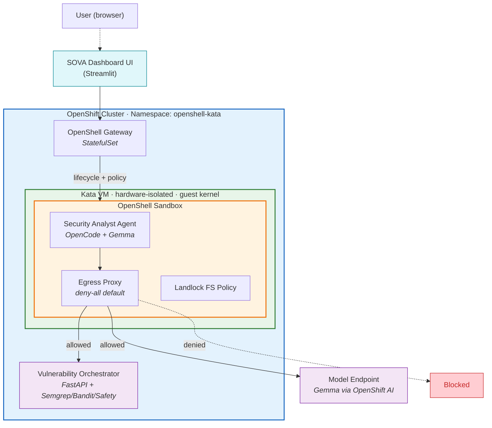

# SOVA - Sovereign Vulnerability Analysis Agent

Deploy AI-powered vulnerability scanning with defense-in-depth using NVIDIA OpenShell and Kata Containers on Red Hat OpenShift.

## Table of Contents

- [Description](#description)
- [Business Use Case](#business-use-case)
- [Architecture](#architecture)
- [Requirements](#requirements)
- [Deploy](#deploy)
- [Delete](#delete)
- [Security Model](#security-model)
- [References](#references)
- [Tags](#tags)

## Description

AI coding agents need shell access to be productive - running tests,
editing files, installing packages, executing builds. But unrestricted
shell access on a shared cluster creates two distinct threat classes that
must be addressed simultaneously.

**Application-layer threats** such as prompt injection can steer an agent
toward exfiltrating secrets, accessing unauthorized services, or leaking
credentials through network channels. These attacks use normal
application behavior and do not require any runtime vulnerability.

**Kernel-level threats** such as container escape exploits allow
malicious code to break out of the container boundary, access the host
filesystem, or move laterally to other workloads. Since agents routinely
execute untrusted code (`pip install`, `npm install`, arbitrary shell
commands), the kernel attack surface is directly exposed.

This reference architecture deploys AI coding agents inside a
dual-protection boundary: **NVIDIA OpenShell** enforces application-layer
policies (network egress allowlisting, filesystem restrictions, process
isolation), while **Kata Containers** provides hardware-enforced VM
isolation at the kernel level. Together they cover threat classes that
neither technology addresses alone.

## Business Use Case

This quickstart deploys **SOVA (Sovereign Vulnerability Analysis Agent)**: an enterprise-grade,
privacy-first vulnerability scanning platform with a chat UI where users submit Git repository URLs
and receive comprehensive security analysis dashboards with SARIF-formatted vulnerability reports.

The agent performs AI-powered security analysis by orchestrating industry-standard scanning tools
(Semgrep, Bandit, Safety) and provides severity metrics, CWE classifications, and actionable
remediation guidance.

SOVA runs inside a **dual-protection boundary**: OpenShell restricts network egress to only the
vulnerability orchestrator API and model endpoint, while Kata provides hardware VM isolation.
When analyzing potentially malicious repositories or handling prompt injections, the security
boundary prevents data exfiltration - demonstrably enforced and visible in the UI.

*Example: Vulnerability dashboard showing SARIF findings with severity breakdown*

> **Note:** The UI drives the real sandboxed agent via `openshell sandbox exec ... opencode run`,
> so vulnerability reports come from the orchestrator API through the OpenShell + Kata boundary.
> The blocked-egress banner reflects a real `policy_denied` from the egress proxy when malicious
> repositories attempt data exfiltration. The UI image bundles the `openshell` CLI for this.
> The same boundary is verified headlessly by the [Phase 3 demo](3-demo/README.md).

## Architecture




**Components:**

- **Kata VM** (green) - Each agent pod runs inside a lightweight VM with
  its own guest kernel, enforced by CPU virtualization (VT-x/AMD-V).
  Kernel exploits stay contained within the VM boundary.
- **OpenShell Sandbox** (orange) - The security analyst agent runs under an egress proxy
  (deny-all default; only the model endpoint and the vulnerability orchestrator API are
  allowed) and Landlock filesystem policy (kernel-enforced path restrictions).
- **OpenShell Gateway** - StatefulSet managing sandbox lifecycle, policy
  distribution, and JWT authentication.
- **SOVA Dashboard UI** - A Streamlit web application, exposed via an OpenShift Route,
  that accepts Git repository URLs and displays vulnerability analysis dashboards. It sends
  scanning prompts to the agent through the gateway and visualizes SARIF results.
- **Vulnerability Orchestrator API** - A FastAPI service that orchestrates security scanning
  tools (Semgrep, Bandit, Safety), manages scan lifecycle with SQLite, and generates
  SARIF 2.1.0 compliant reports. This is the primary business endpoint the agent calls.
- **External Model Endpoint** - Gemma model served via OpenShift AI (vLLM). The agent uses
  this for analyzing scan results and generating remediation guidance. Not deployed by this quickstart.

## Requirements

### Hardware Requirements

- OpenShift cluster with **bare-metal worker nodes**
- **Hardware virtualization support** (Intel VT-x / AMD-V) required for
  Kata Containers

### Software Requirements

| Tool | Version |
|------|---------|
| Red Hat OpenShift | 4.17+ |
| OpenShift Sandboxed Containers operator | latest |
| NVIDIA OpenShell CLI (`openshell`) | latest |
| `openshell-gateway` binary | latest |
| Helm | 3.x |
| `oc` CLI | matching cluster version |

### Additional Requirements

- An **OpenAI-compatible model endpoint**. We recommend an open-weight model
  such as **IBM Granite** served via **Red Hat OpenShift AI** (vLLM); any
  OpenAI-compatible endpoint works. Set it in `env.sh` as `MODEL_ENDPOINT`.
- A **container image registry** you can push to (e.g., Quay.io)

## Deploy

### Prerequisites

1. Copy and configure environment variables:
   ```bash
   cp env.sh.example env.sh
   # Edit env.sh with your values
   source env.sh
   ```

2. Build and push the images (the sandbox image, vulnerability orchestrator, and UI):
   ```bash
   # Build agent sandbox with security analyst persona
   podman build --platform linux/amd64 -f images/agent-sandbox/Dockerfile \
     -t ${REGISTRY}/openshell-kata-agent-sandbox:latest .
   podman push ${REGISTRY}/${NAMESPACE}/openshell-kata-agent-sandbox:latest

   # Build vulnerability orchestrator API
   podman build --platform linux/amd64 -f images/vuln-orchestrator/Dockerfile \
     -t ${REGISTRY}/vuln-orchestrator-api:latest .
   podman push ${REGISTRY}/${NAMESPACE}/vuln-orchestrator-api:latest

   # Build SOVA dashboard UI
   podman build --platform linux/amd64 -f images/vuln-ui/Dockerfile \
     -t ${REGISTRY}/sova-dashboard-ui:latest .
   podman push ${REGISTRY}/${NAMESPACE}/sova-dashboard-ui:latest
   ```

### Phase 1: Infrastructure (cluster-admin)

Install the Kata Containers runtime on your OpenShift cluster. This
requires cluster-admin privileges and will cause worker nodes to reboot.

→ See [1-infra/README.md](1-infra/README.md)

### Phase 2: Deployment

Deploy the OpenShell gateway and create the dual-protection agent
sandbox.

→ See [2-deploy/README.md](2-deploy/README.md)

### Phase 3: Verify

Confirm that the agent works and security boundaries are enforced.

→ See [3-demo/README.md](3-demo/README.md)

## Delete

Remove all quickstart resources:

```bash
source env.sh
./2-deploy/teardown.sh
```

This removes the sandbox, OpenShell gateway, secrets, namespace, and SCC.
The Kata operator and KataConfig are left in place. To remove them:

```bash
oc delete kataconfig default
oc delete subscription sandboxed-containers-operator \
  -n openshift-sandboxed-containers-operator
```

## Security Model

This architecture protects against two complementary threat classes.
See [docs/security-model.md](docs/security-model.md) for the full
analysis, design rationale, and CVE case studies.

| Threat class | OpenShell | Kata | Both |
|---|---|---|---|
| Data exfiltration via network | Blocks | Allows | Blocks |
| Prompt injection leading to exfiltration | Blocks | Allows | Blocks |
| Container escape via kernel CVE | Allows | Blocks | Blocks |
| Host filesystem access | Allows | Blocks | Blocks |

## References

- [NVIDIA OpenShell documentation](https://github.com/NVIDIA/OpenShell)
- [OpenShift Sandboxed Containers documentation](https://docs.openshift.com/container-platform/latest/sandboxed_containers/)
- [Kata Containers architecture](https://katacontainers.io/docs/)

## Tags

- **Product:** Red Hat OpenShift, OpenShift Sandboxed Containers, OpenShift AI
- **Partner:** NVIDIA
- **Industry:** Software Development, DevSecOps, Enterprise Security
- **Use case:** Vulnerability Scanning, Security Analysis, SAST, Dependency Scanning
